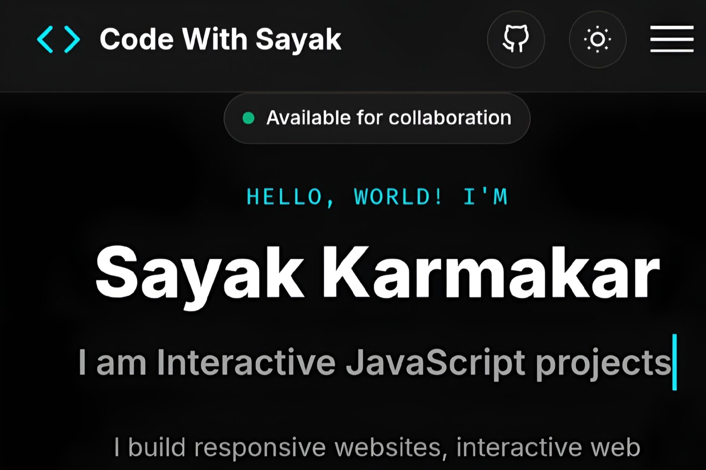
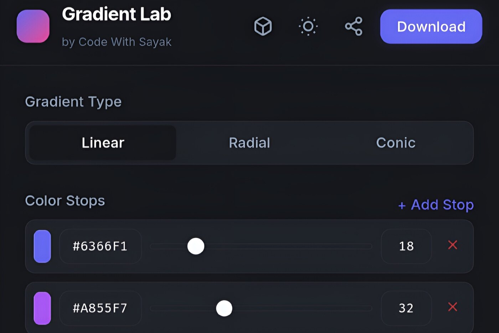
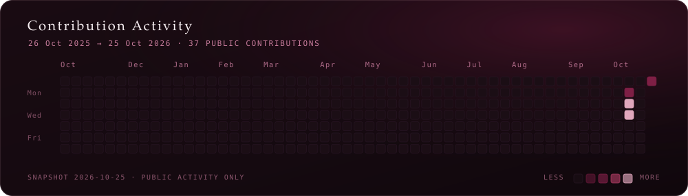

<picture>
  <source media="(max-width: 480px) and (prefers-color-scheme: light)" srcset="assets/sayak-hero-mobile-light.svg">
  <source media="(max-width: 480px)" srcset="assets/sayak-hero-mobile.svg">
  <source media="(prefers-color-scheme: light)" srcset="assets/sayak-hero-light.svg">
  
</picture>

<i>Burgundy by choice. Hand-built in HTML, CSS and SVG.</i>

 

## The short version

I design and build for the web: the interface first, everything else in service of it.
I care about the quiet details — how a grid holds a page together, how type breathes,
how a transition ends instead of just stopping.

I'm a student, learning in public by shipping real projects rather than collecting badges.
Two of them are live and open source today.

<table>
  <tr>
    <td valign="top" width="33%"><b>FOCUS</b> Frontend architecture &amp; interface design</td>
    <td valign="top" width="33%"><b>BASED IN</b> India · remote-friendly</td>
    <td valign="top" width="33%"><b>STATUS</b> Available for collaboration</td>
  </tr>
</table>

<picture>
  <source media="(prefers-color-scheme: light)" srcset="assets/sayak-divider-light.svg">
  
</picture>

## Selected work

Two projects, both MIT licensed, both deployed and reachable. Each description is taken
from its own source code — no invented results, no fake metrics.

<h3>01 &nbsp;·&nbsp; Developer Portfolio</h3>

A personal portfolio built with HTML5, CSS3 and vanilla JavaScript — no frameworks, no build
step. Projects, skills and timeline are driven from a single configuration object, with
real-time project filtering, an accessible detail modal, and scroll reveals via
IntersectionObserver.

&nbsp;

HTML5 · CSS3 · Vanilla JS · LocalStorage · IntersectionObserver

 

<h3>02 &nbsp;·&nbsp; Gradient Lab</h3>

A zero-dependency CSS gradient studio: linear, radial and conic gradients with a color-stop
editor, 24 presets, shareable URLs, and a canvas exporter that renders wallpapers as PNG or
JPEG. Also includes a HEX converter, a WCAG contrast checker and a local image palette
extractor.

&nbsp;

Vanilla JS (ES6+) · Canvas API · CSS Custom Properties · LocalStorage

 

<picture>
  <source media="(prefers-color-scheme: light)" srcset="assets/sayak-divider-light.svg">
  
</picture>

## Craft &amp; toolkit

Grouped honestly: the first two lists are what I build with, the third is where I'm headed.

**Interface &amp; frontend**
`HTML5` · `CSS3` · `JavaScript (ES6+)` · `Responsive web design` · `CSS animations` · `DOM manipulation` · `Local storage` · `CSS custom properties`

**Tools &amp; workflow**
`Git` · `GitHub` · `VS Code` · `Browser DevTools` · `Vercel` · `Figma (foundational)`

**Deliberately learning**
`API integration` · `Web accessibility` · `Performance optimization` · `Progressive web apps`

Nothing above is listed as an expertise claim without a shipped project behind it. The hero, heatmap and footer on this page are hand-authored SVG, so they count too.

<picture>
  <source media="(prefers-color-scheme: light)" srcset="assets/sayak-divider-light.svg">
  
</picture>

## Contribution activity

<picture>
  <source media="(prefers-color-scheme: light)" srcset="assets/sayak-contributions-light.svg">
  
</picture>

This chart is generated from a **real snapshot** of my GitHub contribution calendar, taken
**25 October 2026** and committed as `assets/data/contributions-snapshot.json`. It is not
decorative, and it is not live — it shows public activity up to that date only. The build
script refuses to draw the chart if the snapshot's stated total and its daily cells disagree.

For the live version: [my contribution graph on GitHub →](https://github.com/codewithsayak?tab=overview&from=2025-10-26&to=2026-10-25)

### By the numbers

| Metric | Value | Source |
| :-- | :-- | :-- |
| Public repositories | 3 | GitHub API, 25 Oct 2026 |
| Public contributions, trailing 12 months | 37 | Contribution calendar snapshot |
| Live, shipped projects | 2 | Both deployed and reachable |

Third-party stat cards and streak counters are deliberately absent. They depend on services
I can't verify, they break silently, and a broken image is a worse advertisement than a small
honest table.

<picture>
  <source media="(prefers-color-scheme: light)" srcset="assets/sayak-divider-light.svg">
  
</picture>

## Achievements &amp; certifications

**No certifications are listed here, and that is on purpose.**

I'd rather show an empty shelf than a padded one. I haven't completed a certification I can
back with a verifiable credential, so there is nothing to badge.

What *can* be verified:

- **Two open-source projects shipped and live** — [Portfolio](https://github.com/codewithsayak/Portfolio) and [Gradient Lab](https://github.com/codewithsayak/GRADIENT-LAB), both MIT licensed, both publicly deployed.
- **Self-directed frontend practice**, with a public commit history on GitHub and a written timeline on my [portfolio](https://codewithsayak.vercel.app/#journey).
- **Currently a student**, building in public while studying. No institution, degree or date is claimed here, because none is verified in this repository.

When a credential is real and checkable, it will appear in this section with a link to it.

<picture>
  <source media="(prefers-color-scheme: light)" srcset="assets/sayak-divider-light.svg">
  
</picture>

## Elsewhere

    

Email is the best way to reach me. I read everything and reply to most of it.

 

<picture>
  <source media="(max-width: 480px) and (prefers-color-scheme: light)" srcset="assets/sayak-footer-mobile-light.svg">
  <source media="(max-width: 480px)" srcset="assets/sayak-footer-mobile.svg">
  <source media="(prefers-color-scheme: light)" srcset="assets/sayak-footer-light.svg">
  
</picture>

<!--
  Built by hand: Markdown, HTML, SVG and image embeds only.
  No JavaScript, no external CSS, no iframes, no third-party badge services.
  SVG sources: assets/sayak-hero.svg · assets/sayak-hero-light.svg
               assets/sayak-hero-mobile.svg · assets/sayak-hero-mobile-light.svg
               assets/sayak-footer.svg · assets/sayak-footer-light.svg
               assets/sayak-footer-mobile.svg · assets/sayak-footer-mobile-light.svg
               assets/sayak-divider.svg · assets/sayak-divider-light.svg
               assets/sayak-contributions.svg · assets/sayak-contributions-light.svg
               assets/chips/*.svg
  Builders: tools/build-heatmap.py · tools/build-chips.py
            tools/build-mobile-assets.py
-->
